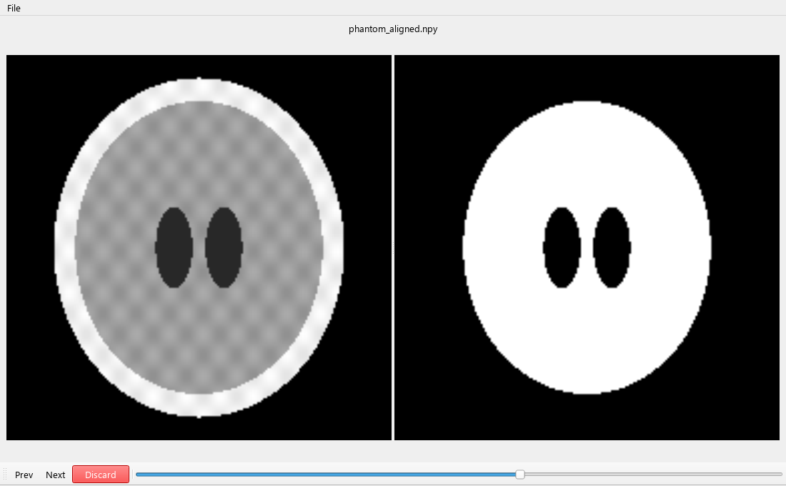

# Medical dataset reviewer

A desktop tool for reviewing medical images beside their segmentation volumes. Browse paired cases, inspect slices, and copy rejected segmentations to a separate folder with a review comment.



The screenshot uses a synthetic phantom. The included demo has an aligned mask and a displaced mask, so you can try the review workflow without downloading a dataset.

## Try it

From a clone of this repository, create a Python environment and install the package:

```bash
git clone https://github.com/MostafaAbdelmegeed/medical_dataset_reviewer.git
cd medical_dataset_reviewer
python -m venv .venv
```

Activate it with `.venv\Scripts\Activate.ps1` in PowerShell, or `source .venv/bin/activate` on macOS/Linux. Then run:

```bash
python -m pip install -e .
python -m seg_qc_tool --demo
```

Demo files live in a temporary directory, and demo mode leaves your saved folder preferences alone. For your own data, start with `python -m seg_qc_tool` or the installed `seg_qc_tool` command.

## Review a dataset

Use **File** to select your originals, segmentations, and a discard destination. The tool supports DICOM series, NIfTI (`.nii` and `.nii.gz`), and NumPy volumes (`.npy`).

| Control | Action |
| :--- | :--- |
| **Prev / Next**, or arrow keys | Move between paired cases |
| Slice slider | Browse a volume |
| **Discard**, or **D** | Add a comment and copy the rejected segmentation to the discard folder |

For DICOM segmentations, discard copies the current slice. For NIfTI and NumPy segmentations, it copies the volume. Source files stay in place. Reviews append to `discard_log.csv` in the working directory.

## Folder layout

```text
dataset/
  originals/
    case_a/                 # DICOM series
      0.dcm
      1.dcm
    case_b.nii.gz
  segmentations/
    case_a_seg/
      0.dcm
      1.dcm
    case_b_seg.nii.gz
```

Pairing uses file or series names, with `_seg`, `_mask`, and `_label` suffixes removed. Nested folders are searched recursively. A folder containing DICOM slices counts as one volume. Check the selected pair before recording a review, especially when names are similar.

## Implementation

The interface uses PySide6. Image loading uses nibabel, pydicom, and SimpleITK, with a small volume cache and a thread pool. The current view shows the original image and mask separately; it does not overlay or resample them. Inputs should already have matching geometry.

## Development

```bash
python -m pip install -e ".[test]"
python -m pytest -q
python tools/capture_demo.py
```

For a display-free capture, set `QT_QPA_PLATFORM=offscreen` before running the capture script. It loads the real application, exercises the slider and pair navigation, and saves the screenshot above.

License: [GPL-3.0](LICENSE).
